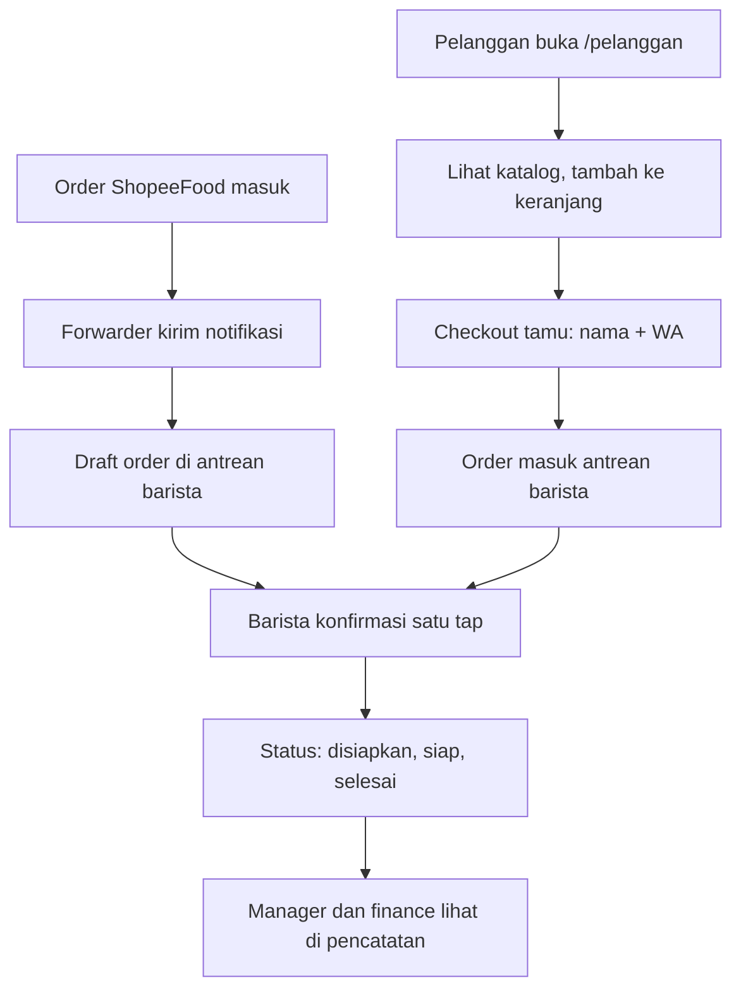

# Dashboard Koperasi MBG

Dashboard buat koperasi MBG: satu web, empat tampilan beda per role.
Manager, finance, barista, pelanggan. Dibangun pake React + Vite +
TypeScript, tampilannya liquid glass di atas foto dermaga kiriman Zaky.

Status: UI + alur demo jalan. Data masih dummy, backend belum ada.

## Cara jalanin

```bash
cd MBG
npm install
npm run dev
```

Buka http://localhost:5173. Buat build produksi:

```bash
npm run build
npm run preview
```

## Cara nyoba login staff

Halaman login staff disembunyiin di route `/kprmbg20asdf`. Tidak ada
link ke sana dari mana pun di web pelanggan, ketik manual URL-nya.

Email demo (DEV STUB, bukan akun beneran):

- `manager@mbg.dev` (role manager)
- `finance@mbg.dev` (role finance)
- `barista@mbg.dev` (role barista)

Masukin email, klik Kirim kode. Kodenya muncul di console browser
dan di halaman login (DEV ONLY, dihapus pas backend jadi). Masukin
kode 6 digit, sesi jalan 30 hari (sliding refresh, tersimpan di
localStorage). Halaman staff (`/manager`, `/finance`, `/barista`)
tanpa sesi bakal dilempar balik ke halaman login.

Pelanggan tidak perlu login. Checkout tamu: nama + nomor WA, lacak
pesanan pake nomor order.

## Alur



ASCII fallback:

```
Pelanggan pesan di web --> antrean barista
ShopeeFood --> forwarder --> draft order --> barista konfirmasi
Barista ubah status --> disiapkan, siap, selesai
Manager dan finance lihat pencatatan
```

## Struktur

```
MBG/
  src/
    app/
      router.tsx      (rute + guard, judul per halaman)
    pages/
      Login.tsx       (login staff, route /kprmbg20asdf)
      Manager.tsx     (stat, grafik omzet, tabel pesanan, laporan)
      Finance.tsx     (kas, transaksi, donat kategori, CSV)
      Barista.tsx     (kanban 3 kolom, katalog warkop, walk-in)
      Pelanggan.tsx   (katalog 2 tab, keranjang, checkout tamu)
    components/
      TopBar.tsx      (logo, tanggal, nav role, chip user)
      StatCard.tsx    (kartu angka)
      BarChart.tsx    (grafik batang omzet)
      DonutChart.tsx  (donat kategori)
      OrderTable.tsx  (tabel pesanan)
      SlidingTabs.tsx (tab dengan pill yang berjalan)
      StatusPill.tsx  (pill status pesanan)
      GlassCard.tsx   (kartu kaca)
      View.tsx        (animasi masuk halaman)
      RequireAuth.tsx (guard halaman staff)
      icons.tsx       (ikon SVG inline)
    features/
      manager/
        ReportPanel.tsx
      finance/
        TransactionForm.tsx
      barista/
        OrderCard.tsx
        KanbanColumn.tsx
      pelanggan/
        ProductCard.tsx
        CartPanel.tsx
        OrderTracker.tsx
        PelangganLoader.tsx (loader teko tuang kopi)
        loader.css
    lib/
      dummy.ts        (semua data contoh, ganti api.ts nanti)
      format.ts       (fmtRp)
      auth-api.ts     (DEV STUB OTP, diganti Worker + D1)
      auth-session.ts (sesi localStorage, 30 hari sliding)
    styles/
      tokens.css      (token desain dari DESIGN.md)
      components.css  (kaca, tombol, tabel, tab, animasi)
    assets/
      bg-pier.jpg     (foto dermaga kiriman Zaky)
  SKETSA-DASHBOARD.md (sketsa awal)
  DESIGN.md           (bukan di sini, ada di workspace Muse)
```

## Siapa mengerjakan apa

| Bagian | File |
| --- | --- |
| Tampilan per role | `src/pages/*.tsx` |
| Komponen dipakai ulang | `src/components/*.tsx` |
| Logika per role | `src/features/*/*.tsx` |
| Data contoh | `src/lib/dummy.ts` |
| Login dan sesi | `src/lib/auth-api.ts`, `src/lib/auth-session.ts` |
| Token warna dan kaca | `src/styles/tokens.css`, `src/styles/components.css` |
| Rute dan guard | `src/app/router.tsx` |

## Mau ubah... | Edit...

| Mau ubah... | Edit... |
| --- | --- |
| Data produk, pesanan, transaksi | `src/lib/dummy.ts` |
| Warna, kaca, radius, animasi | `src/styles/tokens.css`, `src/styles/components.css` |
| Nambah role baru | `src/pages/`, `src/app/router.tsx`, `src/lib/auth-api.ts` |
| Ganti backend dummy ke API beneran | `src/lib/dummy.ts` jadi `src/lib/api.ts` |
| Nambah email staff | `src/lib/auth-api.ts` (sementara; nanti via bot Telegram ke D1) |
| Ganti foto background | `src/assets/bg-pier.jpg` |
| Ganti path login tersembunyi | `src/app/router.tsx` (rute `/kprmbg20asdf`) |

## Batasan yang perlu diingat

- Semua angka, nama barang, dan pesanan itu dummy. Bukan data asli.
- Login masih DEV STUB. Kode OTP cuma simulasi di browser, tidak ada
  email beneran yang terkirim. Backend asli (Worker + D1 allowlist)
  itu langkah berikut, butuh akun Cloudflare owner.
- Path login acak (`/kprmbg20asdf`) itu cuma bonus biar tidak gampang
  ketemu dirsearch. Keamanan benerannya tetap allowlist + OTP +
  rate limit di backend nanti.
- Tombol "Simpan ke Sheet" dan "Download laporan" (manager) cuma
  nunjukin pesan demo. Download CSV (finance) sudah jalan beneran
  di browser.
- Deep link ShopeeFood masih placeholder. Web ke ShopeeFood cuma
  deep link, bukan injeksi order, karena ShopeeFood tidak punya
  API publik.
- Font Inter dimuat dari Google Fonts, jadi butuh internet pas
  pertama buka. Tanpa internet, fallback ke system font.
- Rute pake BrowserRouter, jadi harus jalan lewat dev server atau
  preview, bukan dibuka langsung file HTML-nya.
- Foto produk belum ada, thumbnail masih tile gradien + inisial.
