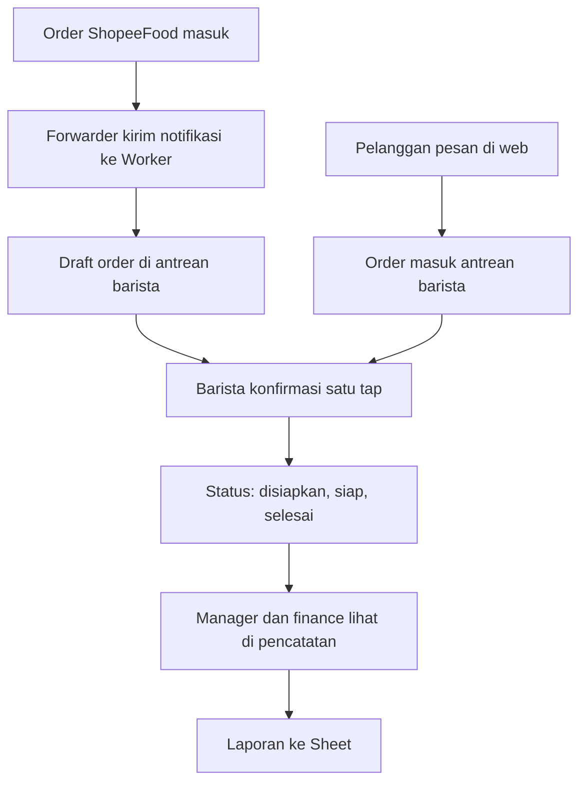

# Sketsa Dashboard Koperasi MBG

Status: sketsa awal, 2026-11-08. Bukan build, bukan final. Tujuannya biar
Zaky bisa lihat susunannya dulu, koreksi, baru kita bangun sekali.

Sumber requirement: Azizzy via WA, 2026-11-07. Role: manager, finance,
pelanggan, barista (warkop bagian dari koperasi). Kemungkinan nambah role.

## Aturan main

- Satu web, empat tampilan beda per role. Login dulu, baru kelihatan menu
  sesuai role. Pelanggan tidak login pun bisa lihat katalog, tapi pesan
  harus login.
- Stack: React (Vite + TypeScript) biar gampang maintenance. Backend
  (Worker + D1 + Sheet mirror) nanti, sketsa ini UI dulu.
- Warna dan logo belum ada. Sketsa ini sengaja abu-abu, tanpa warna brand.
  DESIGN.md via design-md-studio dibuat pas build, setelah ada materi
  brand koperasi.
- Data di sketsa ini dummy. Angka dan nama barang cuma contoh.

## 1. Manager

Fokus: pencatatan dan gambaran usaha hari ini.

Layout:

- Bar atas: logo, nama manager, tanggal, tombol keluar.
- Kartu angka (4): omzet hari ini, pesanan hari ini, anggota aktif,
  stok menipis.
- Grafik: omzet 7 hari terakhir (batang).
- Tabel: pesanan terbaru (waktu, pelanggan, barang, total, sumber
  Web/ShopeeFood, status).
- Panel laporan: pilih periode, tombol download laporan, tombol simpan
  ke Sheet.

Aksi: lihat detail pesanan, export laporan, atur jam buka warkop,
lihat stok.

## 2. Finance

Fokus: pencatatan keuangan, semua harus bisa ditarik ke spreadsheet.

Layout:

- Bar atas: sama seperti manager, dengan nama finance.
- Kartu angka (3): kas masuk bulan ini, kas keluar bulan ini, saldo kas.
- Tabel pencatatan: tanggal, keterangan, kategori, masuk, keluar, saldo
  berjalan. Bisa cari dan filter per kategori dan periode.
- Tombol: tambah transaksi, download laporan (Sheet/CSV), simpan laporan
  ke Sheet.
- Panel: rekap per kategori (donat atau daftar).

Aksi: tambah/edit/hapus transaksi, export laporan, cocokkan saldo
dengan Sheet.

Catatan: finance tidak bisa lihat nomor WA pelanggan dan tidak bisa ubah
harga atau menu. Itu wewenang manager dan barista.

## 3. Barista

Fokus: antrean pesanan, cepat dan jelas. Dipakai di HP atau tablet
di warkop.

Layout:

- Bar atas: nama barista, toggle Buka/Tutup warkop, jam.
- Tiga kolom status: Baru, Disiapkan, Siap.
- Kartu pesanan: nomor order, item dan jumlah, total, sumber
  (Web atau ShopeeFood), waktu masuk, tombol aksi.
- Draft ShopeeFood ditandai jelas: "Draft, cek item dulu" karena teks
  notifikasi kadang tidak lengkap.
- Panel bawah: katalog warkop (tandai habis/tersedia), tombol tambah
  pesanan walk-in.

Aksi: konfirmasi draft satu tap, ubah status (disiapkan, siap,
selesai), tandai menu habis, catat walk-in.

Catatan: pesanan ShopeeFood harus dikonfirmasi cepat (maks 3 menit
sebelum auto-batal di aplikasi Shopee Partner). Antrean diurutkan dari
yang paling lama menunggu.

## 4. Pelanggan

Fokus: katalog dan pesan, sesimpel mungkin.

Layout:

- Bar atas: logo, cari, keranjang, tombol masuk.
- Dua tab katalog: Barang Koperasi, Warkop. Isinya beda, tidak dicampur.
- Grid produk: foto, nama, harga, stok, tombol tambah.
- Keranjang: daftar item, total, tombol pesan.
- Status pesanan: diterima, disiapkan, siap, selesai.
- Tombol: pesan lewat ShopeeFood (deep link ke toko, dicatat dulu
  item dan totalnya sebelum redirect).

Aksi: cari barang, tambah ke keranjang, pesan, lacak pesanan,
buka ShopeeFood.

Catatan: arah web ke ShopeeFood cuma deep link, bukan injeksi order.
Order ShopeeFood tetap dibuat pelanggan di aplikasi Shopee.

## Alur pesanan



## Struktur React (rencana)

```
MBG/
  src/
    pages/
      Login.tsx
      Manager.tsx
      Finance.tsx
      Barista.tsx
      Pelanggan.tsx
    components/
      TopBar.tsx
      StatCard.tsx
      OrderCard.tsx
      ProductCard.tsx
      ReportPanel.tsx
    lib/
      api.ts        (client ke Worker, nanti)
      auth.ts       (role dan session, nanti)
      dummy.ts      (data contoh buat sketsa)
```

Satu halaman per role, komponen dipakai ulang. Nanti pas backend jadi,
`dummy.ts` diganti `api.ts` tanpa ubah tampilan.

## Yang belum diputuskan

- Warna dan logo koperasi. Butuh materi brand dari owner.
- Menu warkop dan metode bayar (tunai, QRIS, ShopeeFood).
- Kegiatan harian koperasi selain warkop (distribusi, simpan pinjam,
  pengadaan). Ini nentuin isi pencatatan manager dan finance.
- Sheet jadi sumber utama atau mirror dari D1. Rekomendasi tetap D1
  utama + Sheet mirror, tapi owner minta data di GSheet, jadi perlu
  dipastikan.
- Role tambahan di kemudian hari. Struktur role sudah dibuat gampang
  nambah.

## Batasan sketsa ini

- Semua angka dan nama barang dummy.
- Belum ada login beneran, belum ada backend, belum ada Sheet.
- Bukan desain final. Warna, font, dan detail visual diputuskan pas
  DESIGN.md.
